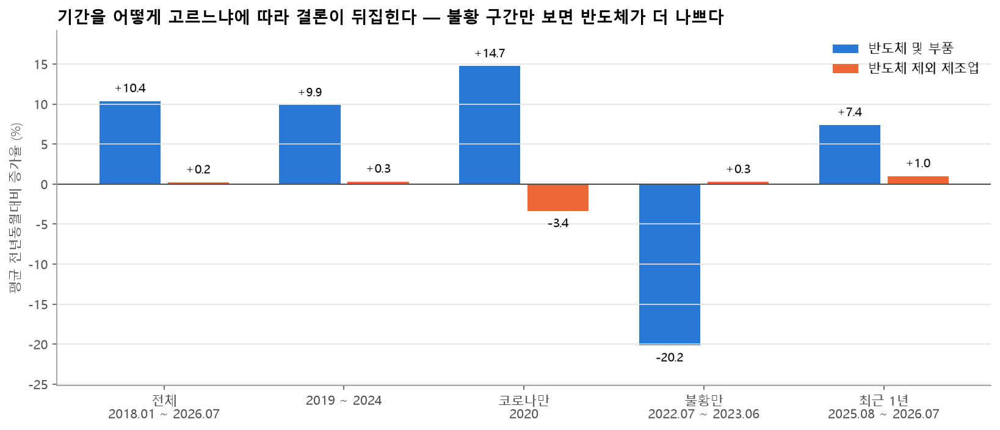

# 반도체만 날았나? — 반도체 vs 비반도체 제조업 생산지수 시계열 분석 리포트

> 분석 기간: 2017.01 ~ 2026.07 (월별 115개)
>
> 자료: 통계청 KOSIS 광공업생산지수(2020=100)
>
> 코드: [`analysis.ipynb`](analysis.ipynb) / 정제 데이터: [`data/clean_production.csv`](data/clean_production.csv)

## 1. 분석 주제 및 선정 이유

- 2026 경제학과 학술제에서 "반도체 호황, 그 온기는 내수까지 도달했는가"를 다루고 있다. 따라서 해당 주제에 필요한 시계열 분석 리포트를 작성하게 되었다.
- 뉴스에서는 "반도체 호황"이라고 말하지만, 체감 경기는 좋지 않다는 이야기도 많다. 그래서 반도체가 아닌 제조업도 함께 좋아졌는지, 아니면 반도체만 위로 올라간 것인지를 데이터로 직접 확인하고자 한다.
- 교수님 피드백("인과를 단정하지 말고 선행성·시차 관계를 보여라", "코로나 시기까지 넣어 비교하라")을 반영해 2017년부터 10년 가까운 월별 자료를 쓰고, 상관과 시차로만 말하는 것으로 설정했다.

## 2. 분석 질문

| # | 질문 | 유형 | 판단 기준 (분석 전에 정함) |
|---|---|---|---|
| Q1 | 반도체와 비반도체 제조업의 생산 추세는 **언제부터, 얼마나** 벌어졌나? | 그래프로 확인 | 2017년 평균 = 100으로 맞춘 12개월 이동평균의 차이로 판단한다. 비반도체가 100 아래로 계속 내려가면 'K자형', 제자리면 '한쪽만 오르는 격차'로 본다 |
| Q2 | 호황·불황 **국면마다** 증가율과 변동성은 어떻게 달랐나? | 그래프로 확인 | 국면별 평균 YoY의 부호(+/-)를 비교한다. 반도체 YoY 표준편차가 비반도체의 2배 이상이면 '훨씬 더 출렁인다'로 본다 |
| Q3 | 반도체 **재고**는 생산과 어떤 순서로 움직였나? | 확인 + 해석 | 재고 YoY 정점과 생산 YoY 저점 중 어느 쪽이 먼저인지(개월 수), 시차 상관의 부호로 판단한다 |
| Q4 | 반도체 생산이 늘면 **비반도체 제조업도 시차를 두고** 따라 늘었나? (파급효과) | 해석 필요 | 시차 -6 ~ +6개월 상관계수 중 가장 큰 값이 0.5 이상이면 '함께 움직인다', 0.3 미만이면 '연결이 약하다'로 본다 |

## 3. 데이터 설명

| 항목 | 내용 |
|---|---|
| 출처 | 통계청 KOSIS > 광업제조업동향조사 > 「기타분류별 광공업생산지수(2020=100)」 |
| 수집 방법 | KOSIS 웹에서 엑셀 직접 다운로드 (2026-09-28 조회) → `data/raw/`에 원본 보관 |
| 기간 | 2017.01 ~ 2026.07, **월별 115개** (2026.06, 2026.07은 잠정치 `p)`) |
| 사용 행 | ① **반도체 및 부품(C26A)** = 반도체(C261) + 전자부품(C262) ② **반도체 및 부품 제외 제조업** = ①을 뺀 나머지 제조업 |
| 사용 지표 | 생산지수, 출하지수, 재고지수 (모두 원지수, 2020년 평균 = 100) |
| 컬럼(정제 후) | `semi_prod`, `semi_ship`, `semi_inv`, `nonsemi_prod`, `is_preliminary` + 파생지표(이동평균, 전년동월대비, 변동성 등) |

### KSIC 코드란

통계청의 한국표준산업분류(KSIC)가 산업마다 붙인 번호다. 이 분석에 나오는 코드는 다음과 같다.

| 코드 | 뜻 |
|---|---|
| C | 제조업 전체 |
| C261 | 반도체 제조업 |
| C262 | 전자부품 제조업 (디스플레이 패널, 인쇄회로기판 등) |
| C26A | C261 + C262, 즉 반도체 및 부품 (통계청이 묶어서 발표하는 분류) |

### 왜 'C26A 제외'를 썼나

반도체 쪽이 C26A(반도체 + 전자부품)이므로, 비교 대상도 **같은 기준으로 C26A를 뺀 행**을 썼다.

같은 엑셀에 있는 '반도체(C261)만 제외'한 행을 쓰면 전자부품(C262)이 두 그룹에 동시에 들어간다. 그러면 전자부품이 움직일 때 두 그룹이 함께 움직여, 실제보다 서로 연결된 것처럼 보일 수 있다.

C26A를 빼면 제조업 = C26A + 나머지로 겹침 없이 나뉜다.

### 왜 월 단위인가

KOSIS 원자료가 월별이고, 반도체 사이클은 몇 달 안에 꺾이기 때문에 분기로 묶으면 꺾이는 시점이 흐려진다.

대신 월별 원지수는 계절에 따른 오르내림이 크다. 그래서 추세를 볼 때는 12개월 이동평균을, 성장 속도를 볼 때는 전년동월대비 증가율을 썼다.

**분기로 묶으면 어떻게 달라지나 (노트북 10장에서 직접 비교):**

| 비교 | 월별 | 분기별 (3개월 평균) |
|---|---|---|
| 데이터 개수 | 115개 | 39개 (2026년 3분기는 7월 1개월만 있음) |
| 반도체 YoY 최저 | 2023.02, -37.6% | 2023년 1분기, -31.7% |
| 반도체 YoY 최고 | 2024.02, +51.3% | 2024년 1분기, +35.3% |
| 2022년 이후 처음 마이너스로 꺾인 시점 | 2022.08 | 2022년 3분기 (7 ~ 9월 중 언제인지 알 수 없음) |
| 반도체 YoY 표준편차 | 15.1%p | 14.0%p |

- 분기로 묶으면 최저점·최고점이 각각 6%p, 16%p 정도 무뎌진다.
- 꺾인 달을 특정할 수 없어 '재고 급증 → 다음 달 감산' 같은 순서를 확인할 수 없다.
- 데이터가 39개로 줄어 과제 조건(100개 이상)도 맞추지 못한다.

### 3-1. 전처리 요약

노트북 1 ~ 2장에서 한 일을 순서대로 정리하면 다음과 같다.

1. **불러오기:** KOSIS 엑셀을 머리글 없이 읽는다. 1행은 날짜, 2행은 지표 이름(생산/출하/재고), 3행부터 산업이다.
2. **행 고르기:** 행 이름으로 `반도체 및 부품(C26A)`과 `반도체 및 부품 제외(C26A제외) → 제조업`을 찾는다.
3. **가로 → 세로 변환:** 한 달에 3칸(생산·출하·재고)씩 옆으로 펼쳐진 값을, 날짜가 행이 되는 표로 바꾼다.
4. **열 이름 정리:**
   - 반도체 생산 → `semi_prod`
   - 반도체 출하 → `semi_ship`
   - 반도체 재고 → `semi_inv`
   - 반도체 제외 제조업 생산 → `nonsemi_prod`
5. **날짜 변환:** `2026.07 p)` 같은 글자를 날짜(2026-07-01)로 바꾸고, 잠정치(p) 여부는 `is_preliminary` 열에 True/False로 남긴다.
6. **숫자 변환:** `pd.to_numeric(errors='coerce')`로 숫자로 바꾼다. 숫자가 아닌 값은 NaN이 된다.
7. **파생지표 추가:**
   - `*_ma12`: 12개월 이동평균
   - `*_yoy`: 전년동월대비 증가율(%)
   - `*_vol12`: 증가율의 12개월 표준편차
   - `*_ma12_r17`: 이동평균을 2017년 평균 = 100으로 환산한 값
8. **저장:** `data/clean_production.csv` (115행 × 19열)

### 3-2. 정제 데이터 샘플 (`data/clean_production.csv`)

첫 5행:

| date | semi_prod | semi_ship | semi_inv | nonsemi_prod | is_preliminary | semi_prod_ma12 | semi_prod_yoy |
|---|---:|---:|---:|---:|---|---:|---:|
| 2017-01 | 68.797 | 70.038 | 99.307 | 100.953 | False | (없음) | (없음) |
| 2017-02 | 62.057 | 66.182 | 94.158 | 101.271 | False | (없음) | (없음) |
| 2017-03 | 70.308 | 75.917 | 88.713 | 115.148 | False | (없음) | (없음) |
| 2017-04 | 64.323 | 68.963 | 94.950 | 109.428 | False | (없음) | (없음) |
| 2017-05 | 71.121 | 73.388 | 106.238 | 108.369 | False | (없음) | (없음) |

참고용 행:

| date | semi_prod | semi_ship | semi_inv | nonsemi_prod | is_preliminary | semi_prod_ma12 | semi_prod_yoy |
|---|---:|---:|---:|---:|---|---:|---:|
| 2018-01 | 73.5 | 79.1 | 107.9 | 105.7 | False | 72.6 | 6.8 |
| 2026-07 | 154.6 | 119.3 | 109.7 | 112.8 | True | 154.1 | 2.0 |

- 2017년에는 이동평균과 증가율이 비어 있다. 12개월 평균과 1년 전 비교에는 앞선 12개월이 필요하기 때문이다(결측이 아니라 계산상 생기는 빈칸).
- 2026-07의 `semi_prod` 154.6은 원본 엑셀 값과 직접 대조해 같음을 확인했다.

### 3-3. 결측치·이상치 처리

| 점검 | 결과 | 처리 기준 |
|---|---|---|
| 결측치 | 4개 지표 모두 **0개** | 숫자로 바뀌지 않는 값('-')은 NaN으로 바꿔 개수를 셌다. 0개라서 보간하지 않았다 |
| 빠진 달 | **0개** (2017.01부터 2026.07까지 연속) | 날짜 범위와 대조해 확인 |
| 잠정치 | 2026.06, 2026.07 | `is_preliminary` 열로 표시하고 분석에는 포함했다. 한계점에 적었다 |
| 이상치 | 전년동월대비 증가율이 평균 ±3σ를 넘는 달 (목록은 부록 A) • 반도체 2023.02 (-37.6%) • 비반도체 2020.05 (-16.1%) | **삭제하지 않고 표시만 했다.** • 반도체 2023.02는 같은 달 출하도 -33.2%로 함께 급락해, 입력 오류가 아닌 실제 불황으로 판단했다. • 비반도체 2020.05는 코로나 1차 충격 시기다. 둘 다 이 분석이 설명하려는 현상이다 |

## 4. 시계열 기본 개념과 분석 기법

### 4-1. 시계열을 이루는 세 가지: 추세 / 계절성 / 노이즈

시계열 값(원지수)은 세 가지를 더한 것으로 볼 수 있다. 그래프 6(STL 분해)이 반도체 생산지수를 실제로 이 셋으로 나눈 그림이다.

**① 추세(트렌드)**

- 뜻: 길게 봤을 때 어느 방향으로 가는가.
- 내 데이터: 반도체 추세는 67.6에서 156.6으로 꾸준히 올라갔다. 2022 ~ 2023년에 한 번 꺾였다.

**② 계절성**

- 뜻: 매년 같은 시기에 반복되는 오르내림.
- 내 데이터: 9월(+12.2)과 12월(+8.8)은 높고, 1월·2월·4월(약 -9)은 낮다.
- 가능한 이유(가설): 설 연휴로 일하는 날이 적은 달은 낮고, 분기 말·연말에는 실적을 맞추려고 생산·출하가 몰린다.

**③ 노이즈(잔차)**

- 뜻: 추세와 계절성으로 설명되지 않는 나머지.
- 내 데이터: 평소에는 ±7 정도로 작다. 2022 하반기 ~ 2023 상반기에만 -20 ~ -33으로 크게 튄다. 예상하지 못한 충격(반도체 불황)이 있었다는 뜻이다.

**정리:** 반도체는 추세 강도 0.92, 계절성 강도 0.44로, 움직임의 대부분이 추세에서 나온다.

### 4-2. 12개월 이동평균 — 왜, 어떻게

- **왜:** 원지수는 계절성 때문에 매달 들쭉날쭉해서, 지금 진짜로 오르는 중인지 보이지 않는다.
- **어떻게:** 최근 12개월 값을 평균 낸다.
  - 코드: `df[c].rolling(window=12).mean()`
  - 파라미터: `window=12`, `min_periods`는 기본값(12). 그래서 12개월이 다 모이기 전에는 값을 만들지 않는다.
  - 12개월 안에는 1월부터 12월까지가 한 번씩 다 들어가므로, 높은 달과 낮은 달이 서로 상쇄돼 **추세만 남는다.**
- **해석 예시:** 반도체 이동평균이 2022.07에 182.6(2017년 = 100)으로 정점을 찍고 2023.07에 143.9까지 내려갔다. 이는 "한두 달 반짝 떨어진 것이 아니라 1년 내내 생산 수준이 낮아졌다"는 뜻이다.
- **단점:**
  - 처음 11개월은 값이 없다. 그래서 이동평균 선은 2017년 12월부터 시작한다.
  - 과거 12개월을 평균 내기 때문에 꺾이는 시점을 늦게 보여준다.

### 4-3. 전년동월대비 증가율(YoY) — 왜, 어떻게

- **왜 지난달이 아니라 작년 같은 달과 비교하나:** 예를 들어 9월에서 10월로 가면 계절적으로 원래 내려간다. 지난달과 비교하면 "줄었다"고 착각한다. 작년 10월과 비교하면 계절 효과가 빠진다.
- **어떻게:** (올해 값 ÷ 작년 같은 달 값 − 1) × 100
  - 코드: `df[c].pct_change(periods=12, fill_method=None) * 100`
  - 파라미터: `periods=12`(12개월 전과 비교), `fill_method=None`(빈 값을 앞의 값으로 채우지 않음)
- **해석 예시:** 2023.02의 -37.6%는 "2022년 2월보다 생산이 37.6% 적었다"는 뜻이다. 계절과 상관없이 실제로 생산이 크게 줄었다고 읽을 수 있다.
- **단점(기준효과):** 작년이 너무 나빴으면 올해 증가율이 부풀어 보인다. 2024.02의 +51.3%가 그 예다. 1년 전인 2023.02가 불황 바닥이었기 때문이다. 그래서 증가율과 이동평균(수준)을 함께 봤다.

### 4-4. 그 밖의 기법

| 기법 | 어떻게 (파라미터) | 왜 | 해석 예시 |
|---|---|---|---|
| 국면별 구간 통계 | 7개 국면별 YoY `mean()`, `std()` | 시기마다 성장과 출렁임이 어떻게 다른지 비교한다 | ⑤ 불황에서 반도체 -20.2%, 비반도체 +0.3% → 반도체 불황이 제조업 전체 불황은 아니었다 |
| 변동성(표준편차) | YoY의 `std()` (표본 표준편차), 12개월 이동 표준편차 `rolling(12).std()` | 반도체가 얼마나 '출렁이는' 산업인지 숫자로 본다 | 15.1%p 대 5.4%p → 반도체가 약 2.8배 더 출렁인다 |
| 이상치 표시 | z = (값 − 평균) ÷ 표준편차, 기준: z의 절댓값 > 3 | 오류인지 실제 충격인지 따로 확인할 달을 고른다 | 2023.02 z = -3.19 → 출하도 같이 급락해 실제 불황으로 판단 |
| 시차 상관 | `x.corr(y.shift(-k))`, k = -6 ~ +6, 피어슨 상관, 빈 값은 짝지어 제외 | 어느 쪽이 먼저 움직이는지(선행성)를 본다. 인과는 아니다 | 최대 0.23 → 0.3 미만이라 '연결이 약하다' |
| (보너스) STL 분해 | `STL(period=12, robust=True)`, 계절 평활 창(seasonal)은 기본값 7 | 추세 / 계절성 / 잔차를 분리한다 | 추세 강도 0.92 → 움직임 대부분이 추세에서 나온다 |
| (보너스) 베이스라인 예측 | 2025.08 ~ 2026.07을 가리고 Naive, Seasonal Naive, Seasonal Naive × 성장배수로 예측, MAE·MAPE로 평가 | 과거 패턴이 반복된다는 가정이 언제 깨지는지 본다 | 성장이 계속된다는 예측이 가장 많이 틀림 → 성장이 둔화됐다 |

`robust=True`는 2022 ~ 2023년 같은 큰 충격이 추세·계절성을 끌고 가지 않도록, 튀는 값의 영향을 줄이는 옵션이다.

### 4-5. 국면 구분 — 언제가 호황이고 언제가 불황인가

국면 경계는 반도체 업황 흐름과 그래프에서 꺾이는 지점을 보고 분석자가 미리 정했다.

'배경'은 일반적으로 알려진 업황 설명이며, 이 데이터로 원인을 검증한 것은 아니다.

| 국면 | 기간 | 반도체 생산 YoY 평균 | 판단 | 배경 |
|---|---|---:|---|---|
| ① 메모리 슈퍼사이클 | 2017.01 ~ 2018.12 | +14.8% | **호황** | 데이터센터 서버 수요가 늘고 메모리 가격이 크게 올랐다 |
| ② 다운사이클 | 2019.01 ~ 2019.12 | +5.6% | 둔화 | 메모리 가격 하락, 미중 무역분쟁. 생산은 늘었지만 속도가 느려졌다 |
| ③ 코로나 | 2020.01 ~ 2020.12 | **+14.7%** | **호황** | 재택근무·원격수업으로 노트북·서버 수요가 늘었다 |
| ④ 비대면 특수 | 2021.01 ~ 2022.06 | +20.6% | **호황** | 코로나 특수가 이어졌다 |
| ⑤ 반도체 불황 | 2022.07 ~ 2023.06 | **-20.2%** | **불황** | 금리 인상으로 IT 기기 수요가 줄고, 재고가 쌓이고, 메모리 가격이 떨어졌다 |
| ⑥ 회복 | 2023.07 ~ 2024.12 | +18.7% | 회복 | 업계 감산으로 재고가 줄고, AI 서버 수요가 늘기 시작했다 |
| ⑦ AI·HBM 호황 | 2025.01 ~ 2026.07 | +9.5% | **호황** | AI용 고대역폭 메모리(HBM) 수요. 생산 수준은 역대 최고지만 증가 속도는 느려졌다 |

**주의: 코로나 시기는 반도체 불황이 아니었다.**

- 코로나(2020년)에 반도체 생산은 오히려 **+14.7% 늘었다.** 이때 줄어든 것은 나머지 제조업(-3.4%)이다.
- 반도체 불황은 코로나 특수가 끝난 뒤인 **2022년 7월 ~ 2023년 6월**이다.
- 10년 중 반도체 생산이 뚜렷하게 줄어든 국면은 ⑤ 하나뿐이다.

## 5. 분석 결과 및 시각화

| 번호 | 그래프 | 구분 | 답하는 질문 |
|---|---|---|---|
| 1 | 같은 출발점 추세 비교 | **필수** | Q1 |
| 2 | 전년동월대비 증가율 | **필수** | Q1, Q2 |
| 3 | 국면별 평균·변동성 | 권장 | Q2 |
| 4 | 재고와 생산 | 권장 | Q3 |
| 5 | 시차 상관 | 권장 | Q3, Q4 |
| 6 | 시계열 분해 | 보너스 A | 추세·계절성·노이즈 |
| 7 | 베이스라인 예측 | 보너스 B | 앞으로도 같은 흐름일까 |
| 8 | 기간 민감도 | 권장 (한계 검증) | 기간을 바꾸면 결론이 달라지나 |

### 그래프 1. 같은 출발점에서 반도체만 2배, 나머지는 제자리 (Q1)

> 사용 컬럼: `semi_prod_ma12_r17`, `nonsemi_prod_ma12_r17` (굵은 선), `semi_prod`, `nonsemi_prod` (옅은 선) / 요약: 2026.07 기준 213.4 대 100.8

원자료는 '2020년 = 100' 기준이라 그대로 그리면 두 선이 2020년에 억지로 만나 교차하는 것처럼 보인다. 그래서 두 산업 모두 **2017년 평균 = 100**으로 다시 환산해 출발점을 맞췄다. 환산해도 증가율은 바뀌지 않는다.

- **관찰:** 12개월 이동평균 기준 반도체 및 부품은 **100 → 213.4(2026.07), 2.1배**가 됐다. 같은 기간 비반도체 제조업은 **100 → 100.8로 제자리**다.
- 반도체는 2022.07에 182.6까지 오른 뒤 불황으로 2023.07에 143.9까지 내려갔다. **가장 나빴을 때도 출발점보다 44% 높았다.**
- 비반도체는 10년 동안 **93.5(2020.08, 코로나) ~ 100.8** 사이에 머물렀다. **출발점보다 뚜렷하게 내려간 적도, 올라간 적도 없다.**
- **그래서 이 모양은 K자형이 아니다.** K자형은 한쪽이 오를 때 다른 쪽은 **내려가는** 모양인데, 비반도체는 내려가지 않고 제자리였다. 정확한 표현은 **'반도체 독주(한쪽만 오르는 격차)'**다.

### 그래프 2. 성장 속도 — 전년동월대비 증가율 (Q1, Q2)

> 사용 컬럼: `semi_prod_yoy`, `nonsemi_prod_yoy` / 요약: 표준편차 15.1%p 대 5.4%p, 같은 달 상관 0.08

- **관찰:** 반도체 YoY의 표준편차는 **15.1%p**, 비반도체는 **5.4%p**다. 반도체가 **약 2.8배** 더 출렁인다.
- 103개월 중 YoY가 마이너스였던 달은 반도체 **19개월**, 비반도체 **51개월**(약 절반)이다.
- 반도체 최고점은 **2024.02 +51.3%**(불황 직후의 기준효과), 최저점은 **2023.02 -37.6%**다.
- 같은 달끼리 본 두 산업 YoY의 상관계수는 **0.08**로, 거의 따로 움직인다.

### 그래프 3. 국면별 평균 증가율과 변동성 (Q2)

> 사용 컬럼: `semi_prod_yoy`, `nonsemi_prod_yoy`를 국면별로 집계 (`data/phase_stats.csv`) / 요약: 반도체가 마이너스인 국면은 ⑤ 하나(-20.2%)

| 국면 | 반도체 평균 YoY | 비반도체 평균 YoY | 반도체 σ | 비반도체 σ |
|---|---:|---:|---:|---:|
| ① 슈퍼사이클 | +14.8% | -1.7% | 7.5 | 6.3 |
| ② 다운사이클 | +5.6% | -1.1% | 8.3 | 2.5 |
| ③ 코로나 | **+14.7%** | **-3.4%** | 6.8 | 6.7 |
| ④ 비대면 특수 | +20.6% | +3.9% | 4.3 | 5.1 |
| ⑤ 반도체 불황 | **-20.2%** | +0.3% | 10.2 | 3.6 |
| ⑥ 회복 | +18.7% | +0.2% | 14.0 | 3.9 |
| ⑦ AI·HBM 호황 | +9.5% | +1.0% | 8.6 | 5.8 |

※ ① 국면은 2017년에 전년 자료가 없어 2018년 12개월만으로 계산했다.

- **관찰:** 7개 국면 중 반도체가 마이너스였던 국면은 ⑤ 하나뿐이다. 비반도체가 가장 크게 오른 국면도 ④의 +3.9%에 그친다.
- 코로나 국면(③)에서 반도체는 +14.7%, 비반도체는 -3.4%로 **방향이 반대**였다.
- 반대로 반도체 불황(⑤)에서 반도체가 -20.2%로 떨어질 때 비반도체는 +0.3%로 **함께 떨어지지 않았다.**

### 그래프 4. 반도체 재고와 생산 (Q3)

> 사용 컬럼: `semi_prod_yoy`, `semi_inv_yoy` (본문 수치에는 `semi_ship_yoy`도 사용) / 요약: 생산 저점 2023.02, 재고 정점 2023.05

- **관찰:** 2022.03에서 2022.07 사이에 반도체 **재고 증가율이 +14%에서 +54%로** 치솟는 동안 **출하 증가율은 +12.5%에서 -16.6%로** 떨어졌다.
- 그 직후인 **2022.08부터 생산 증가율이 마이너스(-13.2%)**로 돌아섰다.
- 생산 저점은 **2023.02(-37.6%)**, 재고 증가율 정점은 그보다 3개월 늦은 **2023.05(+60%)**다.
- 2024 ~ 2025년에는 반대로 재고 증가율이 24개월 내내 마이너스(-1.7% ~ -41.1%)였고, 생산은 플러스를 유지했다.

### 그래프 5. 시차 상관 — 누가 먼저 움직이나 (Q3, Q4)

> 사용 컬럼: `semi_prod_yoy`, `nonsemi_prod_yoy`, `semi_inv_yoy` / 요약: 반도체-비반도체 최대 0.23, 재고-생산 최소 -0.45

- **관찰 (반도체 생산 vs 비반도체 생산):** 시차 -6 ~ +6개월 모두 상관계수가 **-0.11 ~ 0.23**으로 약하다. 가장 큰 값은 반도체가 4개월 앞설 때의 **0.23**이다.
- **관찰 (반도체 재고 vs 반도체 생산):** 모든 시차에서 **음(-)의 상관**이다. 가장 강한 값은 k = -4(생산이 4개월 먼저, 재고가 뒤따름)의 **-0.45**다.

### 그래프 6. (보너스 A) 반도체 생산지수 시계열 분해

> 사용 컬럼: `semi_prod` (원지수) / 요약: 추세 강도 0.92, 계절성 강도 0.44

- **관찰:** 추세 성분이 67.6에서 156.6으로 움직이는 동안 계절성 진폭은 약 48포인트, 잔차 표준편차는 7.6포인트다.
- **추세 강도 0.92, 계절성 강도 0.44**로, 움직임의 대부분은 추세가 설명한다.
- 월별 평균 계절성분은 **9월(+12.2)과 12월(+8.8)이 높고, 1월·2월·4월(약 -9)이 낮다.**
- 2022 하반기 ~ 2023 상반기에는 잔차가 -20 ~ -33으로 크게 음(-)이다. 추세와 계절로 설명되지 않는 **충격**이었다는 뜻이다.

### 그래프 7. (보너스 B) 베이스라인 예측

> 사용 컬럼: `semi_prod` (원지수) / 요약: Naive MAPE 5.7%로 가장 정확, 성장 가정은 8.5%

2025.08 ~ 2026.07(12개월)을 모르는 미래로 가리고, 그 이전 자료만으로 예측했다.

| 방법 | 가정 | MAE | MAPE |
|---|---|---:|---:|
| Naive | 다음 달 = 마지막 달(2025.07) | 8.8 | **5.7%** |
| Seasonal Naive | 올해 = 작년 같은 달 | 10.9 | 6.8% |
| Seasonal Naive + 추세 | 작년 같은 달 × 최근 성장배수(1.116) | 13.0 | 8.5% |
| (비교) GPT 예측 | GPT가 고른 홀트-윈터스(가법 추세 + 승법 계절성) | 9.2 | 6.1% |

- **관찰:** "성장이 계속된다"고 가정한 방법이 **가장 많이 틀렸고**, 예측값이 실제보다 계속 높았다.
- 실제로 반도체 YoY는 2025.09 +29.6% 이후, **2025.10 ~ 2026.07에 대부분 0 ~ 3%대**로 둔화됐다.

**GPT 예측과의 비교**

같은 조건(2025.07까지의 103개월만 제공, 실제 값과 인터넷 검색 사용 금지)으로 GPT에게 12개월 예측을 시키고, 같은 방식으로 채점했다. 그래프 7에는 넣지 않고 표로만 비교했다.

| 월 | 실제 | GPT 예측 | 차이 |
|---|---:|---:|---:|
| 2025-08 | 154.9 | 156.4 | +1.5 |
| 2025-09 | 178.6 | 162.5 | -16.1 |
| 2025-10 | 141.4 | 160.6 | +19.2 |
| 2025-11 | 149.6 | 161.1 | +11.5 |
| 2025-12 | 161.2 | 168.9 | +7.7 |
| 2026-01 | 130.1 | 144.5 | +14.4 |
| 2026-02 | 150.6 | 137.7 | -12.9 |
| 2026-03 | 165.4 | 162.3 | -3.1 |
| 2026-04 | 151.1 | 147.7 | -3.4 |
| 2026-05 | 148.7 | 158.3 | +9.6 |
| 2026-06 | 162.8 | 168.1 | +5.3 |
| 2026-07 | 154.6 | 160.5 | +5.9 |

- **관찰:** GPT는 MAPE 6.1%로 네 방법 중 2위였다. Seasonal Naive 두 방법보다는 정확했지만 Naive(5.7%)보다는 덜 정확했다.
- **관찰:** 12개월 중 8개월을 실제보다 높게 예측했고, 평균 오차는 +3.3이었다.
- **관찰:** 1 ~ 2월이 낮다는 계절 패턴을 반영해 2026.02를 137.7로 낮게 잡았지만, 실제는 150.6이었다. 역대 최고인 2025.09(178.6)도 예측하지 못했다.
- **해석:** GPT도 과거 추세가 이어진다고 가정해서 최근의 성장 둔화를 놓쳤다. 이는 "성장이 계속된다"는 가정이 이 기간에 맞지 않았다는 위의 결론을 뒷받침한다.

### 그래프 8. 기간을 바꾸면 결론이 달라지나 — 기간 민감도

> 사용 컬럼: `semi_prod_yoy`, `nonsemi_prod_yoy`를 기간별로 평균 / 요약: 불황 구간만 보면 반도체 -20.2% 대 비반도체 +0.3%

| 기간 | 반도체 평균 YoY | 비반도체 평균 YoY | 같은 달 상관 | 개월 |
|---|---:|---:|---:|---:|
| 전체 (2018.01 ~ 2026.07) | +10.4% | +0.2% | 0.08 | 103 |
| 2019 ~ 2024 | +9.9% | +0.3% | 0.13 | 72 |
| 코로나만 (2020) | +14.7% | -3.4% | 0.51 | 12 |
| 불황만 (2022.07 ~ 2023.06) | -20.2% | +0.3% | 0.19 | 12 |
| 최근 1년 (2025.08 ~ 2026.07) | +7.4% | +1.0% | 0.05 | 12 |

- **관찰:** 긴 기간(전체, 2019 ~ 2024)에서는 "반도체가 훨씬 빨리 성장했다"는 결론이 그대로다.
- 그러나 **불황 구간만 잘라 보면 반도체가 나머지 제조업보다 20%p 이상 나빴다.** 결론이 뒤집힌다.
- 코로나 1년만 보면 같은 달 상관이 0.51로 높게 나온다. 전체 기간(0.08)과 크게 다르다. 12개월짜리 짧은 구간의 상관은 몇 달의 충격에 크게 흔들린다는 뜻이다.
- **그래서 이 리포트의 결론은 '10년 전체를 봤을 때'라는 조건이 붙는다.** 짧은 구간 하나만 보고 반대 결론을 내리지 않도록, 결론에는 항상 기간을 함께 적었다.

## 6. 인사이트

### 인사이트 한눈에 보기

| # | 인사이트 | 핵심 수치(관찰) | 근거 그래프 |
|---|---|---|---|
| 1 | K자형이 아니라 '반도체 독주' | 2017년 = 100 기준 213 대 101, 비반도체 범위 93.5 ~ 100.8 | 그래프 1 |
| 2 | 생산 단계의 파급은 약하다 | 같은 달 상관 0.08, 시차 최대 0.23, 불황 때 -20.2% 대 +0.3% | 그래프 3, 5 |
| 3 | 경고등은 '재고 급증 + 출하 둔화' | 재고 +14% → +54%, 출하 +12.5% → -16.6%, 다음 달 생산 마이너스 | 그래프 4, 5 |
| 4 | 생산 증가 속도는 이미 둔화 | 최근 3개월 YoY 1 ~ 3%, 성장 가정 예측 MAPE 8.5%(최하위) | 그래프 2, 7 |

### 인사이트 1. 반도체는 2배, 나머지 제조업은 제자리 — K자형이 아니라 '반도체 독주'다

**관찰(Fact)**

- 반도체 생산지수(12개월 이동평균)는 2017.12에서 2026.07까지 72에서 154로(**+113%**) 늘었다.
- 비반도체 제조업은 107에서 108로(**+0.8%**) 그쳤다.
- 2017년 평균 = 100으로 맞추면 213 대 101이다.
- 비반도체는 10년 동안 93.5 ~ 100.8 사이에 머물러 **하락하지도 않았다** (그래프 1).

**해석(Why, 가설)**

1. 한국 제조업 성장이 사실상 반도체 한 업종에 의존하고 있다.
2. 비반도체 제조업(자동차·화학·철강 등)은 중국과의 경쟁과 내수 부진으로 정체됐을 수 있다.
3. 반도체 호황이 나머지 제조업을 끌어내린 것(K자형)이 아니라, 나머지 제조업은 반도체와 상관없이 원래 흐름대로 정체된 것으로 보인다. 인사이트 2의 상관 0.08과도 맞는다.

- 한계: 이 데이터는 '생산량'만 보여주므로 원인을 직접 확인한 것은 아니다.
- 한계: 비반도체를 하나로 묶었기 때문에, 그 안에서 줄어든 업종과 늘어난 업종이 서로 상쇄됐을 가능성은 남아 있다.

**행동(Action)**

1. 학술제 Ⅳ파트 1장("반도체 생산지수 추이")에 그래프 1을 그대로 쓴다. (근거: 그래프 1, 213 대 101)
2. "호황"이라는 단어 앞에 **"반도체 업종에 한정된"**이라는 조건을 붙여 발표한다. (근거: 비반도체 +0.8%)
3. 팀 주제의 "K자형 양극화"라는 표현은 생산지수로는 뒷받침되지 않으므로 **"반도체 독주"로 바꾸자고 팀에 제안한다.** K자형을 주장하려면 업종별로 쪼개 실제로 줄어든 업종이 있는지 먼저 확인해야 한다. (근거: 비반도체 범위 93.5 ~ 100.8, Q1 판단 기준)

### 인사이트 2. 반도체가 오르든 내리든 비반도체 제조업은 따라 움직이지 않았다 — 생산 단계의 파급은 약하다

**관찰(Fact)**

- 두 산업 YoY의 같은 달 상관은 0.08이다.
- 시차 ±6개월 중 최대도 0.23(반도체가 4개월 앞설 때)이다 (그래프 5).
- 코로나 국면에서는 반도체 +14.7%, 비반도체 -3.4%로 방향이 반대였다 (그래프 3).
- 반도체 불황 때(-20.2%) 비반도체는 +0.3%였다 (그래프 3).

**해석(Why, 가설)**

1. 반도체는 수출 비중이 매우 높다. 그래서 생산이 늘어도 국내 다른 제조업에 주는 중간재 수요가 크지 않을 수 있다.
2. 반도체 장비·소재의 상당 부분을 수입에 의존하면 국내 파급이 해외로 새어 나간다.

- 반례 가능성: 생산지수는 '양'만 측정한다. 임금·세수·주가 같은 '소득 경로'로는 파급이 있을 수 있고, 이 분석으로는 그 경로를 판단할 수 없다.

**행동(Action)**

1. 학술제 Ⅳ파트의 '낙수효과 첫 번째 병목' 근거로 쓴다. 인과가 아니라 "선행·동행 관계가 약하다"로 표현한다. (근거: 그래프 5, 최대 상관 0.23으로 기준 0.3 미만)
2. 다음 단계로 산업연관표의 반도체 생산·취업유발계수를 확인해 이 가설을 보강한다. (출처: 7장 '추가로 필요한 데이터')

### 인사이트 3. 반도체 사이클의 경고등은 '재고 급증 + 출하 둔화'였다

**관찰(Fact)**

- 2022년 3월에서 7월 사이에 재고 증가율이 +14%에서 +54%로 올랐다.
- 같은 기간 출하 증가율은 +12.5%에서 -16.6%로 꺾였다.
- 바로 다음 달인 2022.08부터 생산이 마이너스로 돌아섰다 (그래프 4).
- 재고와 생산의 시차 상관은 모든 시차에서 음수(최소 -0.45)였다 (그래프 5).

**해석(Why, 가설)**

1. 수요가 꺾이면 먼저 출하가 줄어든다.
2. 팔리지 않은 물건이 재고로 쌓인다.
3. 그다음 기업이 생산을 줄인다(감산).
4. 감산이 이어지면 재고는 생산 저점(2023.02)보다 늦게 정점(2023.05)을 찍고 줄어든다.

- 그래서 재고는 생산을 미리 알려주는 지표라기보다, **재고와 출하가 반대로 벌어질 때 켜지는 경고 신호**로 읽는 것이 맞아 보인다.
- 한계: 사례가 2022년 한 번뿐이라 일반화하기 어렵다.

**행동(Action)**

1. 현재(2026.07) 재고 증가율이 -41%(2025.11)에서 **+11%로 다시 올라오는 중**이다. (근거: 그래프 4 오른쪽 끝)
2. 학술제 결론의 '위험요인'에 "재고 반등 여부를 지켜봐야 한다"를 넣을 수 있다. (근거: 2022년 재고 +54% 직후 감산 사례, 그래프 4)
3. 출하지수와 함께 매달 확인할 것을 제안한다.

### 인사이트 4. 지금의 '호황'은 생산 '수준'은 높지만 생산 '증가 속도'는 이미 둔화됐다

**관찰(Fact)**

- 2025.10 ~ 2026.07 반도체 생산 YoY는 2026.02(+22.4%)를 빼면 대부분 **-2% ~ +11%**다.
- 최근 3개월은 **1 ~ 3%**다 (그래프 2).
- "성장이 계속된다"고 본 예측이 MAPE 8.5%로 가장 많이 틀렸다 (그래프 7).
- 반면 학술제 자료(관세청)에서는 2026년 9월 반도체 **수출액**이 전년 대비 +259%였다.

**해석(Why, 가설)**

1. 생산지수는 **물량**을 재고, 수출액은 **물량 × 가격**이다.
2. 물량 증가가 둔화됐는데도 수출액이 폭증했다면, 이번 호황은 **가격(단가)이 이끈 호황**일 가능성이 크다.
3. 학술제 기획안 Ⅰ파트의 "물량 vs 가격 분해" 질문에 대한 하나의 근거가 된다.

- 한계: 수출 물가지수로 직접 확인해야 한다.

**행동(Action)**

1. Ⅰ파트 담당자에게 공유해 반도체 수출물가지수(ECOS)와 비교하도록 제안한다. (근거: 생산 YoY 1 ~ 3% 대 수출액 +259%)
2. 가격이 이끈 호황은 가격이 꺾이면 빠르게 식을 수 있으므로, 결론의 위험요인에 포함한다. (근거: 그래프 7, 성장 가정 예측이 가장 많이 틀림)

## 7. 결론 및 한계점

### 결론

1. **반도체 생산은 2017년 대비 2배 넘게 늘었지만 나머지 제조업 생산은 제자리였다.**
   나머지 제조업이 하락한 것은 아니므로 K자형이 아니라 **'반도체 독주'**다.

2. **반도체 생산의 움직임은 비반도체 제조업 생산과 거의 연결되지 않았다** (상관 0.08, 시차 최대 0.23).
   '반도체 호황 → 다른 제조업 생산 증가'라는 경로는 이 자료에서는 약하다.

3. **반도체 사이클은 출하 둔화 + 재고 급증 → 감산 순서로 꺾였다.**
   현재는 생산 수준은 높지만 증가 속도가 둔화됐고, 재고가 다시 늘기 시작했다.

### 한계점

- **인과가 아니다:** 상관과 시차만 봤다. 환율, 글로벌 수요, 금리 같은 외부 변수를 통제하지 않았다.
- **생산지수는 '양'만 잰다:** 가격, 이익, 임금, 고용은 보지 못한다. 그래서 '소득 경로'의 파급 여부는 판단할 수 없다.
- **C26A에는 반도체뿐 아니라 전자부품(디스플레이 등)도 포함된다:** 순수 반도체(C261)만 보면 결과가 달라질 수 있다.
- **비반도체 제조업은 하나로 묶었다:** 자동차처럼 따로 좋았던 업종이나 따로 나빴던 업종이 평균에 묻혔을 수 있다.
- **잠정치:** 2026.06, 2026.07은 잠정치라 이후 수정될 수 있다.
- **국면 경계와 분석 기간은 분석자가 정했다:** 그래프 8처럼 기간을 바꾸면 결론이 뒤집힐 수 있다. 불황 구간만 보면 반도체가 더 나빴다.
- **YoY는 기준효과에 민감하다:** 2024.02 +51%처럼 전년이 낮으면 증가율이 과장된다. 이를 보완하려고 이동평균(수준)을 함께 봤다.
- **시차 상관의 표본:** YoY 103개월 안에 큰 사이클은 2 ~ 3번뿐이라, 상관계수가 몇 개 사건에 좌우된다.

### 추가로 필요한 데이터

한계를 보완하려면 다음 자료가 필요하다.

| 필요한 자료 | 확인하려는 것 | 출처 (통계표) | 형식 |
|---|---|---|---|
| 반도체 수출물가지수 | 인사이트 4: 호황이 가격 주도인지 | 한국은행 ECOS (ecos.bok.or.kr) > 물가 > 수출물가지수(품목별) > 반도체 | 월별, 엑셀 다운로드 |
| 반도체 월별 수출액 (HS 8541, 8542) | 생산(물량)과 수출(금액)의 차이 | 관세청 수출입무역통계 (tradedata.go.kr) > 품목별 수출입 | 월별, 엑셀 다운로드 |
| 업종별 생산지수 (자동차, 화학, 철강 등) | 인사이트 1: 비반도체 안에 실제로 줄어든 업종이 있는지 (진짜 K자형 여부) | 통계청 KOSIS (kosis.kr) > 광업제조업동향조사 > 산업별 광공업생산지수(2020=100) | 월별, 엑셀 다운로드 |
| 산업연관표 생산·취업유발계수 | 인사이트 2: 반도체의 국내 파급 크기 | 한국은행 ECOS > 산업연관표 > 생산유발계수, 취업유발계수 | 연간(기준년), 엑셀 |
| 산업별 종사자 수 | 생산이 고용으로 이어졌는지 | 고용노동부 사업체노동력조사 (KOSIS 제공) | 월별, 엑셀 다운로드 |

## 8. AI 사용 로그

이 분석은 Claude Code(AI 코딩 도구)와 대화하며 진행했다. 검증 방법은 **AI가 한 것**과 **내가 직접 한 것**을 구분해 적는다.

### ① 주제 선정

- **사용 작업:** AI가 학술제 폴더(기획안, 3차 회의 결과, 교수님 피드백)를 읽고, 이미 받아 둔 KOSIS 데이터로 할 수 있는 주제를 제안했다.
- **사용 이유:** 학술제와 과제를 연결할 대안을 빠르게 찾기 위해.
- **검증 방법:**
  - AI: 제안 주제가 3차 회의에서 채택한 방향, 교수님 피드백(선행성·시차, 코로나 포함)과 맞는지 대조했다.
  - 나: 학술제 폴더 위치를 바로잡아 주고(처음에 다른 폴더를 읽음), 계획서를 읽고 진행을 승인했다.

### ② 전처리

- **사용 작업:** AI가 KOSIS 가로형 엑셀(날짜 × 지표가 열로 펼쳐진 형태)을 세로형 표로 바꾸는 코드를 작성했다.
- **사용 이유:** 여러 줄 머리글이 있는 엑셀을 읽는 코드를 짜는 시간을 줄이기 위해.
- **검증 방법:**
  - AI: 115개월이 빠짐없이 이어지는지, 결측치가 0개인지 코드로 확인했다.
  - 나: 원본 엑셀을 직접 열어 **2026년 7월 반도체 및 부품 생산지수가 154.6**인지 확인했다. 노트북 결과와 같았다 (샘플링 체크).

### ③ 비교 대상(행) 선택

- **사용 작업:** 'C261 제외'와 'C26A 제외' 중 무엇을 비교 대상으로 쓸지 AI가 정했다.
- **사용 이유:** 산업분류 정의를 잘못 쓰는 실수를 막기 위해.
- **검증 방법:**
  - 나: 리포트 설명이 이해되지 않아 AI에게 다시 물었다. 그 과정에서 "겹치거나 빠지는"이라는 설명이 부정확하다는 것을 확인했다. 실제 문제는 "겹침"뿐이라 문장을 고쳤고, KSIC 코드 설명을 추가했다.

### ④ 시각화

- **사용 작업:** AI가 matplotlib 그래프 7개와 웹 대시보드 코드를 작성했다.
- **사용 이유:** 시간 절감.
- **검증 방법:**
  - AI: 그래프 이미지를 열어 글자 겹침과 범례 가림을 고쳤다. 수치와 맞지 않는 제목도 고쳤다. 예를 들어 "재고가 줄어든 뒤 생산이 반등"이라는 제목이 시차 상관 결과(생산이 먼저 움직임)와 맞지 않아 수정했다.
  - 나: 대시보드에서 국면 버튼을 눌러 보며 숫자가 리포트와 같은지 확인했다. 예: '⑤ 불황' 버튼에서 반도체 평균 증가율 -20.2%가 리포트 표와 같았다 (재현).
  - 나: 리포트에서 물결표(~) 사이 글자에 취소선이 생기는 표시 오류를 발견했다.

### ⑤ 해석

- **사용 작업:** AI가 관찰 수치를 정리하고 가능한 해석(가설)을 제안했다.
- **사용 이유:** 여러 해석을 탐색하기 위해.
- **검증 방법:**
  - AI: '관찰'의 숫자를 노트북 출력값과 대조했다. '해석'은 가설로 표시하고 반례와 한계를 함께 적었다. 수출액 +259%는 학술제 기획안의 수치를 인용했다(원자료는 관세청).
  - 나: **AI가 처음에 "생산 측면의 K자형 양극화가 확인된다"고 해석한 것을 그래프와 비교해 반박했다.** 그래프에서 K자 모양이 보이지 않았기 때문이다. 확인해 보니 비반도체 지수는 10년간 93.5 ~ 100.8로 하락하지 않았다. 그래서 결론을 'K자형'에서 '반도체 독주'로 바꿨다. 이 과정에서 2020년 기준 그래프의 교차 착시도 발견해, 그래프 1을 2017년 평균 = 100 기준으로 다시 그렸다.
  - 나: 국면 구분에서 "반도체 불황 = 코로나 시기"라고 생각했다. 그런데 국면별 수치를 보니 코로나(2020년)에 반도체는 +14.7%로 오히려 늘었고, 불황은 2022.07 ~ 2023.06이었다. 이 내용을 4-5절에 정리했다.

### ⑥ GPT 예측 비교

- **사용 작업:** GPT(ChatGPT)에게 2025.07까지의 반도체 생산지수 103개월만 주고 이후 12개월을 예측하게 했다. 채점과 표 정리는 Claude Code가 했다.
- **사용 이유:** 단순한 베이스라인 예측이 정말 의미 있는지, AI가 고른 통계 기법과 비교해 보기 위해.
- **검증 방법:**
  - 나: "예측이 맞는다는 걸 어떻게 믿느냐"는 의문을 제기했다. 그래서 AI가 Naive 방법의 MAE 8.8, MAPE 5.7%를 월별 차이표로 풀어 계산 과정을 확인할 수 있게 했다.
  - AI: GPT 프롬프트에서 2025.08 이후 실제 값을 빼고, 검색과 실제 값 사용을 금지하는 조건을 넣었다.
  - 나: GPT에게 직접 프롬프트를 보내고 답변을 받아 왔다.
  - AI: GPT 예측값과 실제 값의 차이로 MAE와 MAPE를 계산하고, 과대 예측이 몇 달인지 셌다.

### ⑦ 문장 다듬기

- **사용 작업:** AI가 리포트 문장과 표를 정리했다.
- **사용 이유:** 읽기 쉽게 하기 위해.
- **검증 방법:**
  - 나: 문체를 평어로 통일하도록 요청했다. 한 줄에 여러 항목이 붙어 있던 부분을 줄을 나눠 정리하도록 요청했다.
  - 최종 결론은 그래프 수치로 설명할 수 있는 범위로만 한정했다.

## 9. (보너스) 대시보드

기간과 국면을 바꿔 보며 탐색할 수 있는 웹 대시보드다.

- 주소: **https://041211lhs.github.io/semiconductor-kshape-analysis/**
- 원본 파일: `docs/index.html`
- 사용 시나리오: README 참고

## 10. 재현 방법

자세한 내용은 [`README.md`](README.md)를 참고한다.

1. `pip install -r requirements.txt`로 라이브러리를 설치한다.
2. `analysis.ipynb`를 위에서부터 차례로 실행한다.
3. `python dashboard/build_dashboard.py`로 대시보드를 만든다.

## 부록 A. 이상치 목록

전년동월대비 증가율의 z점수 절댓값이 3을 넘는 달이다. 파일로는 `data/outliers.csv`에 저장했다.

| 월 | 지표 | YoY | z점수 | 같은 달 반도체 출하 YoY | 판단 | 처리 |
|---|---|---:|---:|---:|---|---|
| 2023-02 | 반도체 | -37.6% | -3.19 | -33.2% | 출하도 함께 급락 → 실제 불황 | 표시만 함(삭제 안 함) |
| 2020-05 | 비반도체 | -16.1% | -3.04 | +6.4% | 코로나 1차 충격 시기 → 실제 충격 | 표시만 함(삭제 안 함) |
