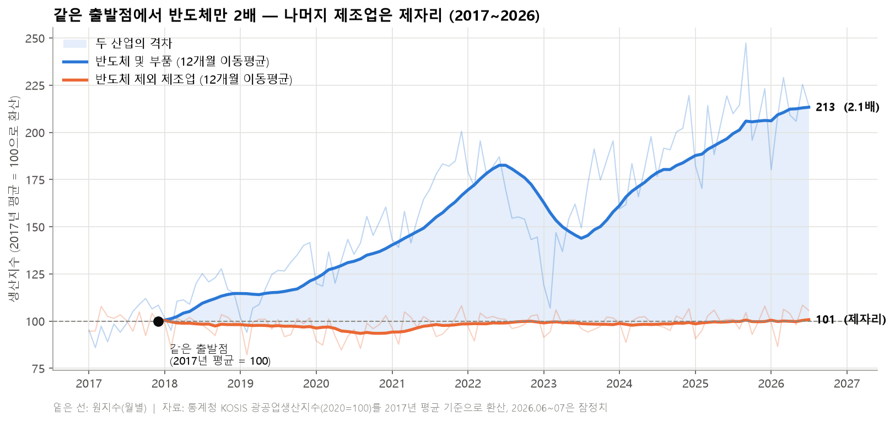
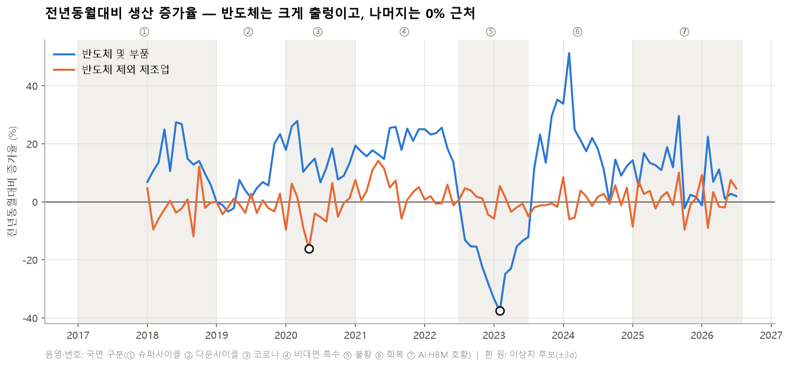
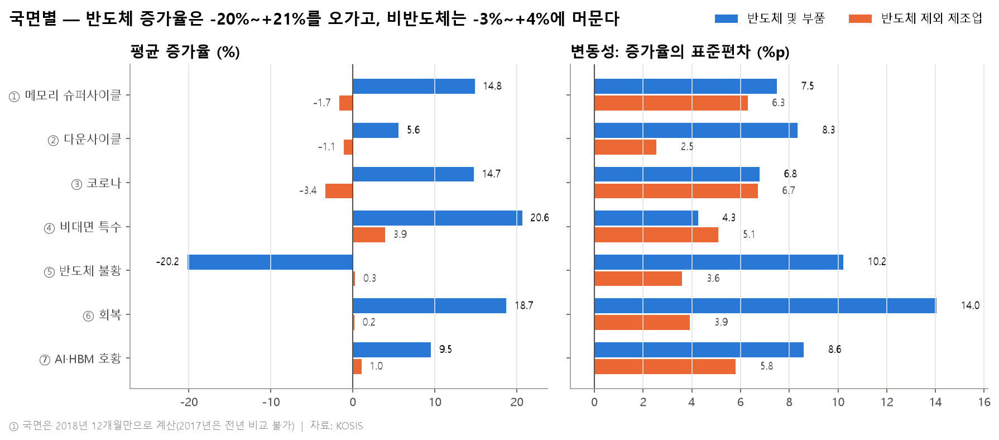
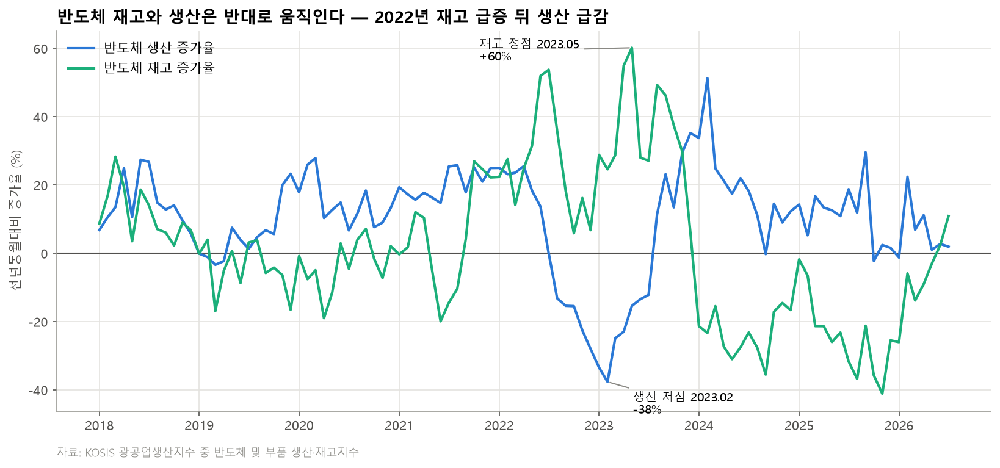
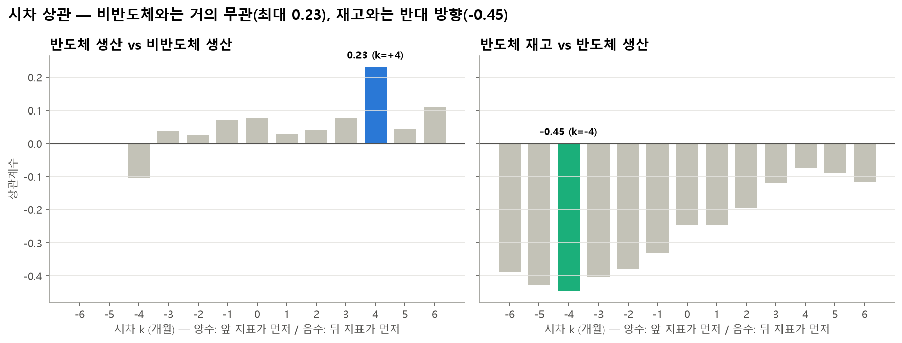
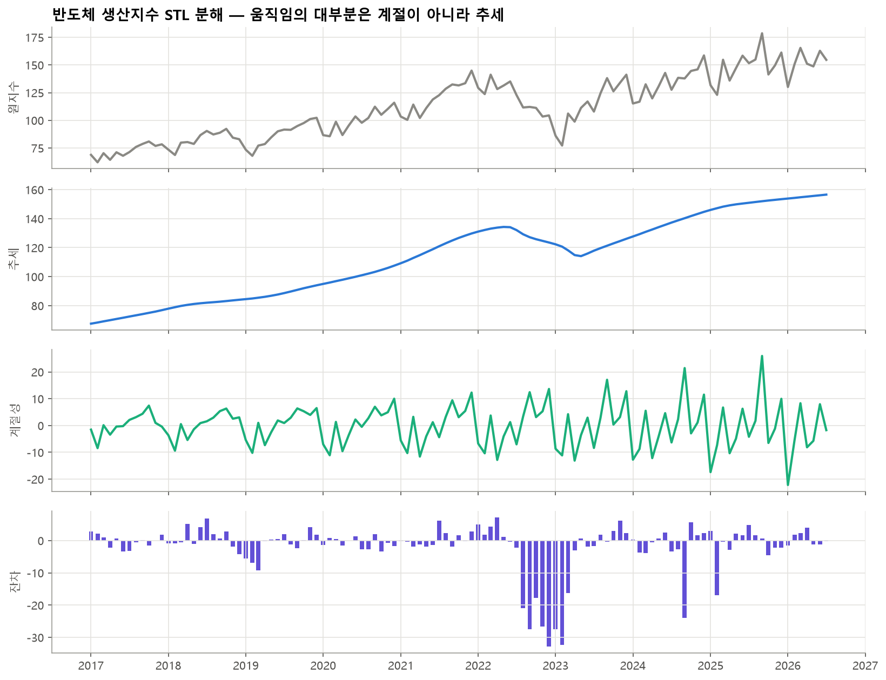
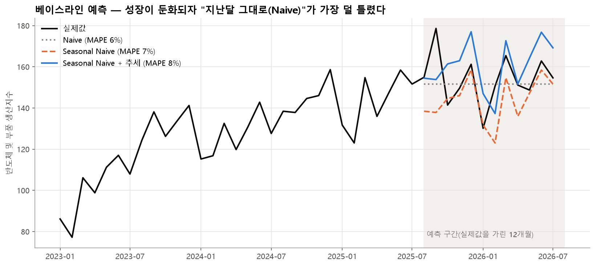
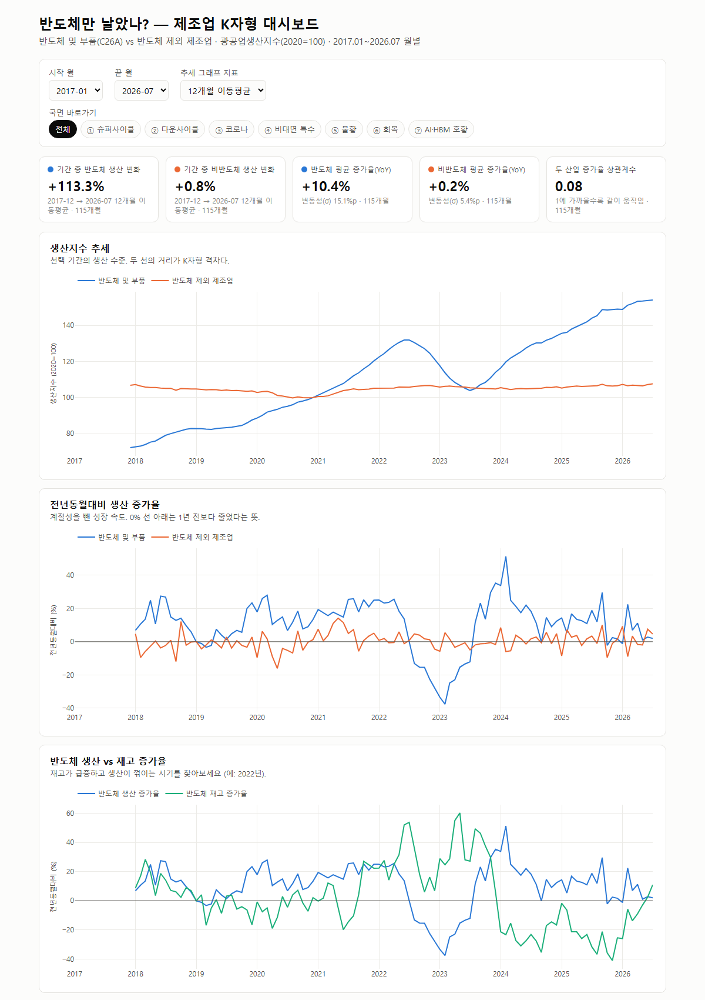

# 반도체만 날았나? — 반도체 vs 비반도체 제조업 생산지수 시계열 분석 리포트

> 분석 기간 2017.01 ~ 2026.07 (월별 115개) · 자료: 통계청 KOSIS 광공업생산지수(2020=100)
> 코드: [`analysis.ipynb`](analysis.ipynb) · 정제 데이터: [`data/clean_production.csv`](data/clean_production.csv)

---

## 1. 분석 주제 및 선정 이유

- 2026 경제학과 학술제에서 "반도체 호황, 그 온기는 내수까지 도달했는가"를 다루고 있다. 따라서 해당 주제에 필요한 시계열 분석 리포트를 작성하게 되었다.
- 뉴스에서는 "반도체 호황"이라고 말하지만, 체감 경기는 좋지 않다는 이야기도 많다. 그래서 반도체가 아닌 제조업도 함께 좋아졌는지, 아니면 반도체만 위로 올라간 것인지를 데이터로 직접 확인하고자 한다.
- 교수님 피드백("인과를 단정하지 말고 선행성·시차 관계를 보여라", "코로나 시기까지 넣어 비교하라")을 반영해 2017년부터 10년 가까운 월별 자료를 쓰고, 상관과 시차로만 말하는 것으로 설정했다.

## 2. 분석 질문

| # | 질문 | 유형 |
|---|---|---|
| Q1 | 반도체와 비반도체 제조업의 생산 추세는 **언제부터, 얼마나** 벌어졌나? | 그래프로 확인 |
| Q2 | 코로나 → 비대면 특수 → 불황 → AI 호황, **국면마다** 증가율과 변동성은 어떻게 달랐나? | 그래프로 확인 |
| Q3 | 반도체 **재고**는 생산과 어떤 순서로 움직였나? | 확인 + 해석 |
| Q4 | 반도체 생산이 늘면 **비반도체 제조업도 시차를 두고** 따라 늘었나? (파급효과) | 해석 필요 |

## 3. 데이터 설명

| 항목 | 내용 |
|---|---|
| 출처 | 통계청 KOSIS > 광업제조업동향조사 > 「기타분류별 광공업생산지수(2020=100)」 |
| 수집 방법 | KOSIS 웹에서 엑셀 직접 다운로드 (2026-09-28 조회) → `data/raw/`에 원본 보관 |
| 기간 | 2017.01 ~ 2026.07, **월별 115개** (2026.06·07은 잠정치 `p)`) |
| 사용 행 | ① **반도체 및 부품(C26A)** = 반도체(C261) + 전자부품(C262) ② **반도체 및 부품 제외 제조업** — ①을 뺀 나머지 제조업 |
| 사용 지표 | 생산지수, 출하지수, 재고지수 (모두 원지수, 2020년 평균 = 100) |
| 컬럼(정제 후) | `semi_prod`, `semi_ship`, `semi_inv`, `nonsemi_prod`, `is_preliminary` + 파생지표(MA12, YoY, 변동성 등) |

**KSIC 코드란:** 통계청의 한국표준산업분류(KSIC)가 산업마다 붙인 번호다. 이 분석에 나오는 코드는 다음과 같다.

| 코드 | 뜻 |
|---|---|
| C | 제조업 전체 |
| C261 | 반도체 제조업 |
| C262 | 전자부품 제조업 (디스플레이 패널, 인쇄회로기판 등) |
| C26A | C261 + C262, 즉 반도체 및 부품 (통계청이 묶어서 발표하는 분류) |

**왜 'C26A 제외'를 썼나:** 반도체 쪽이 C26A(반도체+전자부품)이므로, 비교 대상도 **같은 기준으로 C26A를 뺀 행**을 썼다. 같은 엑셀에 있는 '반도체(C261)만 제외'한 행을 쓰면 전자부품(C262)이 두 그룹에 동시에 들어간다. 그러면 전자부품이 움직일 때 두 그룹이 함께 움직여, 실제보다 서로 연결된 것처럼 보일 수 있다. C26A를 빼면 제조업 = C26A + 나머지로 겹침 없이 나뉜다.

**왜 월 단위인가:** KOSIS 원자료가 월별이고, 반도체 사이클은 몇 달 안에 꺾이기 때문에 분기로 묶으면 꺾이는 시점이 흐려진다. 대신 월별 원지수는 계절 요동이 크므로 추세를 볼 때는 12개월 이동평균을, 성장 속도를 볼 때는 전년동월대비를 썼다.

### 3-1. 결측치·이상치 처리

| 점검 | 결과 | 처리 기준 |
|---|---|---|
| 결측치 | 4개 지표 모두 **0개** | 숫자로 바뀌지 않는 값('-')은 NaN으로 바꿔 개수를 셌다. 0개라서 보간하지 않았다 |
| 빠진 달 | **0개** (2017.01~2026.07 연속) | 날짜 범위와 대조해 확인 |
| 잠정치 | 2026.06, 2026.07 | `is_preliminary` 열로 표시하고 분석에는 포함했다. 한계점에 적었다 |
| 이상치 | 전년동월대비 증가율이 평균 ±3σ를 넘는 달: **반도체 2023.02 (-37.6%)**, **비반도체 2020.05 (-16.1%)** | **삭제하지 않고 표시만 했다.** 반도체 2023.02는 같은 달 출하도 -33.2%로 함께 급락해 입력 오류가 아닌 실제 불황으로 판단했다. 비반도체 2020.05는 코로나 1차 충격 시기다. 둘 다 이 분석이 설명하려는 현상이다 |

## 4. 분석 기법

| 기법 | 어떻게 | 왜 |
|---|---|---|
| 12개월 이동평균 | `rolling(12).mean()` | 원지수의 계절 요동(설·추석 등)을 1년 평균으로 상쇄해 추세만 본다 |
| 전년동월대비 증가율(YoY) | `pct_change(12)` | 같은 달끼리 비교해 계절성을 제거한 성장 속도를 본다 |
| 국면별 구간 통계 | 7개 국면의 YoY 평균·표준편차 | 시기마다 성장과 출렁임이 어떻게 다른지 비교한다 |
| 롤링 변동성 / 표준편차 | YoY의 표준편차 | 반도체가 얼마나 '출렁이는' 산업인지 수치로 본다 |
| 시차 상관 | t월 지표 vs t+k월 지표, k = -6~+6 | 어느 쪽이 먼저 움직이는지(선행성)를 본다. 인과는 아니다 |
| (보너스) STL 분해 | 주기 12개월 | 추세 / 계절성 / 잔차를 분리한다 |
| (보너스) 베이스라인 예측 | 최근 12개월을 가리고 예측 | 과거 패턴 반복 가정이 언제 깨지는지 본다 |

**국면 구분(분석자가 사전에 정함):** ① 메모리 슈퍼사이클(2017~18) ② 다운사이클(2019) ③ 코로나(2020) ④ 비대면 특수(2021.01~2022.06) ⑤ 반도체 불황(2022.07~2023.06) ⑥ 회복(2023.07~2024.12) ⑦ AI·HBM 호황(2025.01~2026.07)

---

## 5. 분석 결과 및 시각화

### 그래프 1. 같은 출발점에서 반도체만 2배, 나머지는 제자리 (Q1)

원자료는 '2020년 = 100' 기준이라 그대로 그리면 두 선이 2020년에 억지로 만나 교차하는 것처럼 보인다. 그래서 두 산업 모두 **2017년 평균 = 100**으로 다시 환산해 출발점을 맞췄다. 환산해도 증가율은 바뀌지 않는다.

- **관찰:** 12개월 이동평균 기준 반도체 및 부품은 **100 → 213.4(2026.07), 2.1배**가 됐다. 같은 기간 비반도체 제조업은 **100 → 100.8로 제자리**다.
- 반도체는 2022.07에 182.6까지 오른 뒤 불황으로 2023.07에 143.9까지 내려갔다. **가장 나빴을 때도 출발점보다 44% 높았다.**
- 비반도체는 10년 동안 **93.5(2020.08, 코로나)~100.8** 사이에 머물렀다. **출발점보다 뚜렷하게 내려간 적도, 올라간 적도 없다.**
- **그래서 이 모양은 K자형이 아니다.** K자형은 한쪽이 오를 때 다른 쪽은 **내려가는** 모양인데, 비반도체는 내려가지 않고 제자리였다. 정확한 표현은 **'반도체 독주(한쪽만 오르는 격차)'**다.

### 그래프 2. 성장 속도 — 전년동월대비 증가율 (Q1·Q2)

- **관찰:** 반도체 YoY의 표준편차는 **15.1%p**, 비반도체는 **5.4%p**다. 반도체가 **약 2.8배** 더 출렁인다.
- 103개월 중 YoY가 마이너스였던 달은 반도체 **19개월**, 비반도체 **51개월**(약 절반)이다.
- 반도체 최고점은 **2024.02 +51.3%**(불황 직후의 낮은 기준 효과), 최저점은 **2023.02 -37.6%**다.
- 같은 달끼리 본 두 산업 YoY의 상관계수는 **0.08**로, 거의 따로 움직인다.

### 그래프 3. 국면별 평균 증가율과 변동성 (Q2)

| 국면 | 반도체 평균 YoY | 비반도체 평균 YoY | 반도체 σ | 비반도체 σ |
|---|---:|---:|---:|---:|
| ① 슈퍼사이클 | +14.8% | -1.7% | 7.5 | 6.3 |
| ② 다운사이클 | +5.6% | -1.1% | 8.3 | 2.5 |
| ③ 코로나 | **+14.7%** | **-3.4%** | 6.8 | 6.7 |
| ④ 비대면 특수 | +20.6% | +3.9% | 4.3 | 5.1 |
| ⑤ 반도체 불황 | **-20.2%** | +0.3% | 10.2 | 3.6 |
| ⑥ 회복 | +18.7% | +0.2% | 14.0 | 3.9 |
| ⑦ AI·HBM 호황 | +9.5% | +1.0% | 8.6 | 5.8 |

- **관찰:** 7개 국면 중 반도체가 마이너스였던 국면은 ⑤ 하나뿐이다. 비반도체가 가장 크게 오른 국면도 ④의 +3.9%에 그친다.
- 코로나 국면(③)에서 반도체는 +14.7%, 비반도체는 -3.4%로 **방향이 반대**였다.
- 반대로 반도체 불황(⑤)에서 반도체가 -20.2%로 떨어질 때 비반도체는 +0.3%로 **함께 떨어지지 않았다.**

### 그래프 4. 반도체 재고와 생산 (Q3)

- **관찰:** 2022.03 → 2022.07에 반도체 **재고 증가율이 +14% → +54%**로 치솟는 동안 **출하 증가율은 +12.5% → -16.6%**로 떨어졌다. 그 직후인 **2022.08부터 생산 증가율이 마이너스(-13.2%)**로 돌아섰다.
- 생산 저점은 **2023.02(-37.6%)**, 재고 증가율 정점은 그보다 3개월 늦은 **2023.05(+60%)**다.
- 2024~2025년에는 반대로 재고 증가율이 24개월 내내 마이너스(-1.7%~-41.1%)였고 생산은 플러스를 유지했다.

### 그래프 5. 시차 상관 — 누가 먼저 움직이나 (Q3·Q4)

- **관찰 (반도체 생산 vs 비반도체 생산):** 시차 -6~+6개월 모두 상관계수가 **-0.11~0.23**으로 약하다. 가장 큰 값은 반도체가 4개월 앞설 때의 **0.23**이다.
- **관찰 (반도체 재고 vs 반도체 생산):** 모든 시차에서 **음(-)의 상관**이다. 가장 강한 값은 k = -4(생산이 4개월 먼저, 재고가 뒤따름)의 **-0.45**다.

### 그래프 6. (보너스 A) 반도체 생산지수 시계열 분해

- **관찰:** 추세 성분이 67.6 → 156.6으로 움직이는 동안 계절성 진폭은 약 48포인트, 잔차 표준편차는 7.6포인트다. **추세 강도 0.92, 계절성 강도 0.44**로, 움직임의 대부분은 추세가 설명한다.
- 월별 평균 계절성분은 **9월(+12.2)과 12월(+8.8)이 높고, 1·2·4월(-9)이 낮다.**
- 2022 하반기~2023 상반기에는 잔차가 -20~-33으로 크게 음(-)이다. 추세와 계절로 설명되지 않는 **충격**이었다는 뜻이다.

### 그래프 7. (보너스 B) 베이스라인 예측

| 방법 | 가정 | MAE | MAPE |
|---|---|---:|---:|
| Naive | 다음 달 = 마지막 달(2025.07) | 8.8 | **5.7%** |
| Seasonal Naive | 올해 = 작년 같은 달 | 10.9 | 6.8% |
| Seasonal Naive + 추세 | 작년 같은 달 × 최근 성장배수(1.116) | 13.0 | 8.5% |

- **관찰:** "성장이 계속된다"고 가정한 방법이 **가장 많이 틀렸고**, 예측값이 실제보다 계속 높았다. 실제로 반도체 YoY는 2025.09 +29.6% 이후 **2025.10~2026.07에 대부분 0~3%대**로 둔화됐다.

---

## 6. 인사이트

### 인사이트 1. 반도체는 2배, 나머지 제조업은 제자리 — K자형이 아니라 '반도체 독주'다
- **관찰(Fact):** 반도체 생산지수(MA12)는 2017.12→2026.07에 72→154(**+113%**)로 늘었고, 비반도체 제조업은 107→108(**+0.8%**)에 그쳤다. 2017년 평균 = 100으로 맞추면 213 vs 101이다. 비반도체는 10년 동안 93.5~100.8 사이에 머물러 **하락하지도 않았다** (그래프 1).
- **해석(Why, 가설):** ① 한국 제조업 성장이 사실상 반도체 한 업종에 의존하고 있다. ② 비반도체 제조업(자동차·화학·철강 등)은 중국과의 경쟁과 내수 부진으로 정체됐을 수 있다. ③ 반도체 호황이 나머지 제조업을 끌어내린 것(K자형)이 아니라, 나머지 제조업은 반도체와 상관없이 원래 흐름대로 정체된 것으로 보인다(인사이트 2의 상관 0.08과도 맞는다). 다만 이 데이터는 '생산량'만 보여주므로 원인을 직접 확인한 것은 아니다. 또 비반도체를 하나로 묶었기 때문에, 그 안에서 줄어든 업종과 늘어난 업종이 서로 상쇄됐을 가능성은 남아 있다.
- **행동(Action):** 학술제 Ⅳ파트 1장("반도체 생산지수 추이")에 그래프 1을 그대로 쓴다. "호황"이라는 단어 앞에 **"반도체 업종에 한정된"**이라는 조건을 붙여 발표한다. 팀 주제의 "K자형 양극화"라는 표현은 생산지수로는 뒷받침되지 않으므로 **"반도체 독주"로 바꾸자고 팀에 제안한다.** K자형을 주장하려면 업종별로 쪼개 실제로 줄어든 업종이 있는지 먼저 확인해야 한다.

### 인사이트 2. 반도체가 오르든 내리든 비반도체 제조업은 따라 움직이지 않았다 — 생산 단계의 파급은 약하다
- **관찰(Fact):** 두 산업 YoY의 같은 달 상관은 0.08, 시차 ±6개월 중 최대도 0.23(반도체 4개월 선행)이다 (그래프 5). 코로나 국면에서는 반도체 +14.7%, 비반도체 -3.4%로 방향이 반대였고, 반도체 불황 때(-20.2%) 비반도체는 +0.3%였다 (그래프 3).
- **해석(Why, 가설):** ① 반도체는 수출 비중이 매우 높아, 생산이 늘어도 국내 다른 제조업에 주는 중간재 수요가 크지 않을 수 있다. ② 반도체 장비·소재의 상당 부분을 수입에 의존하면 국내 파급이 해외로 새어 나간다. **반례 가능성:** 생산지수는 '양'만 측정하므로, 임금·세수·주가 같은 '소득 경로'로는 파급이 있을 수 있다. 이 분석으로는 그 경로를 판단할 수 없다.
- **행동(Action):** 학술제 Ⅳ파트의 '낙수효과 첫 번째 병목' 근거로 쓴다(인과가 아닌 "선행·동행 관계가 약하다"로 표현). 다음 단계로 산업연관표의 반도체 생산·취업유발계수를 확인해 이 가설을 보강한다.

### 인사이트 3. 반도체 사이클의 경고등은 '재고 급증 + 출하 둔화'였다
- **관찰(Fact):** 2022년 3월~7월 재고 증가율이 +14%→+54%로 오르고 출하는 +12.5%→-16.6%로 꺾였다. 바로 다음 달인 2022.08부터 생산이 마이너스로 돌아섰다 (그래프 4). 재고와 생산의 시차 상관은 모든 시차에서 음수(최소 -0.45)였다 (그래프 5).
- **해석(Why, 가설):** 수요가 꺾이면 먼저 출하가 줄고, 팔리지 않은 물건이 재고로 쌓이고, 그다음 기업이 감산한다. 감산이 이어지면 재고는 생산 저점(2023.02) 이후에야 정점(2023.05)을 찍고 줄어든다. 그래서 재고는 생산의 **선행지표라기보다 '재고/출하 격차'가 벌어질 때 경고 신호**로 읽는 것이 맞아 보인다. 사례가 2022년 한 번뿐이라 일반화에는 한계가 있다.
- **행동(Action):** 현재(2026.07) 재고 증가율이 -41%(2025.11)에서 **+11%로 다시 올라오는 중**이다. 학술제 결론의 '위험요인'에 "재고 반등 여부를 지켜봐야 한다"를 넣을 수 있다. 출하지수와 함께 매달 확인할 것을 제안한다.

### 인사이트 4. 지금의 '호황'은 생산 '수준'은 높지만 생산 '증가 속도'는 이미 둔화됐다
- **관찰(Fact):** 2025.10~2026.07 반도체 생산 YoY는 2026.02(+22.4%)를 빼면 대부분 **-2%~+11%**, 최근 3개월은 **1~3%**다 (그래프 2). "성장이 계속된다"고 본 예측이 MAPE 8.5%로 가장 많이 틀렸다 (그래프 7). 반면 학술제 자료(관세청)에서는 2026년 9월 반도체 **수출액**이 전년 대비 +259%였다.
- **해석(Why, 가설):** 생산지수는 **물량**을 재고, 수출액은 **물량 × 가격**이다. 물량 증가가 둔화됐는데도 수출액이 폭증했다면, 이번 호황은 **가격(단가) 주도**일 가능성이 크다. 학술제 기획안 Ⅰ파트의 "물량 vs 가격 분해" 질문에 대한 하나의 근거가 된다. 단, 수출 물가지수로 직접 확인해야 한다.
- **행동(Action):** Ⅰ파트 담당자에게 공유해 반도체 수출물가지수(ECOS)와 비교하도록 제안한다. 가격 주도 호황은 가격이 꺾이면 빠르게 식을 수 있으므로 결론의 한계·위험요인에 포함한다.

---

## 7. 결론 및 한계점

### 결론
1. **반도체 생산은 2017년 대비 2배 넘게 늘었지만 나머지 제조업 생산은 제자리였다.** 다만 나머지 제조업이 **하락한 것은 아니므로 K자형이 아니라 '반도체 독주'**다.
2. **반도체 생산의 움직임은 비반도체 제조업 생산과 거의 연결되지 않았다**(상관 0.08, 시차 최대 0.23). '반도체 호황 → 다른 제조업 생산 증가'라는 경로는 이 자료에서는 약하다.
3. 반도체 사이클은 **출하 둔화 + 재고 급증 → 감산** 순서로 꺾였다. 현재는 생산 수준은 높지만 증가 속도가 둔화됐고 재고가 다시 늘기 시작했다.

### 한계점
- **인과가 아니다:** 상관과 시차만 봤다. 환율, 글로벌 수요, 금리 같은 외부 변수를 통제하지 않았다.
- **생산지수는 '양'만 잰다:** 가격, 이익, 임금, 고용은 보지 못한다. 그래서 '소득 경로'의 파급 여부는 판단할 수 없다.
- **C26A에는 반도체뿐 아니라 전자부품(디스플레이 등)도 포함된다.** 순수 반도체(C261)만 보면 결과가 달라질 수 있다.
- **비반도체 제조업은 하나로 묶었다.** 자동차처럼 따로 좋았던 업종이 평균에 묻혔을 수 있다.
- **잠정치:** 2026.06·07은 잠정치라 이후 수정될 수 있다.
- **국면 경계는 분석자가 정했다.** 경계를 바꾸면 국면별 평균이 달라질 수 있다.
- **YoY는 기준 효과에 민감하다:** 2024.02 +51%처럼 전년이 낮으면 증가율이 과장된다. 이를 보완하려고 이동평균(수준)을 함께 봤다.
- **시차 상관의 표본:** YoY 103개월에 큰 사이클은 2~3번뿐이라 상관계수가 몇 개 사건에 좌우된다.

---

## 8. AI 사용 로그

| 작업 | 사용 내용 | 사용 이유 | 검증 방법 |
|---|---|---|---|
| 주제 선정 | 학술제 폴더(기획안, 회의 결과, 교수님 피드백)를 AI가 읽고, 이미 받아 둔 KOSIS 데이터와 연결되는 주제를 제안 | 학술제와 과제를 연결할 대안을 빠르게 탐색 | 3차 회의에서 채택한 (3)번 주제(K자형 양극화)와 교수님 피드백(선행성·시차, 코로나 포함)에 맞는지 직접 대조 |
| 전처리 | KOSIS 가로형 엑셀을 세로형으로 바꾸는 코드 작성 (Claude Code) | 다중 헤더(날짜×지표) 엑셀 파싱 시간 절감 | 정제 후 2017.01 반도체 생산 68.797, 2026.07 154.6이 원본 엑셀 값과 일치하는지 샘플링 체크. 115개월 연속, 결측 0 확인 |
| 행 선택 | 'C261 제외'와 'C26A 제외' 중 무엇을 비교군으로 쓸지 AI와 검토 | 산업분류 정의 실수 방지 | 비교군이 같은 기준(C26A)으로 빠졌는지 원본 행 이름으로 확인 |
| 시각화 | matplotlib 그래프 7종 코드 작성 | 시간 절감 | 그래프를 직접 열어 보고 글자 겹침, 범례 가림, 과장된 제목을 수정. 예: 처음 제목 "재고가 줄어든 뒤 생산이 반등"이 시차 상관 결과(생산이 먼저)와 맞지 않아 "반대로 움직인다"로 고침. 예측 그래프 제목도 실제 MAPE 순위에 맞게 수정 |
| 해석 | 관찰 수치를 정리하고 가설 후보를 제안 | 대안 해석 탐색 | 모든 '관찰' 숫자는 노트북 출력값과 대조. '해석'은 가설로 표시하고 반례와 한계를 함께 적음. 수출액 +259%는 학술제 기획안 수치를 인용(원자료는 관세청) |
| 해석 재검토 | AI가 처음에 '생산 측면의 K자형 양극화가 확인된다'고 해석했으나, 내가 그래프에서 K자 모양이 보이지 않는다고 지적함 | AI 해석을 그대로 받아들이지 않고 그래프로 검증 | 비반도체 지수가 10년간 93.5~100.8로 하락하지 않았음을 수치로 확인 → 'K자형'(한쪽 하락)이 아니라 '반도체 독주'로 결론 수정. 2020년 기준 그래프의 교차 착시를 없애려고 2017년 평균 = 100으로 다시 그림 |
| 문장 다듬기 | 리포트 문장과 표 정리 | 가독성 | 최종 결론은 그래프 수치로 설명할 수 있는 범위로만 한정 |

---

## 9. (보너스) 대시보드

기간·국면을 바꿔 보며 탐색할 수 있는 웹 대시보드: **https://041211lhs.github.io/semiconductor-kshape-analysis/** (원본 `docs/index.html`, 사용 시나리오는 README 참고)

## 10. 재현 방법
[`README.md`](README.md)를 참고한다. 요약하면 `pip install -r requirements.txt` 후 `analysis.ipynb`를 위에서부터 실행한다.
